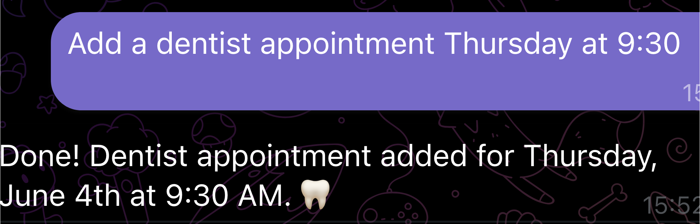
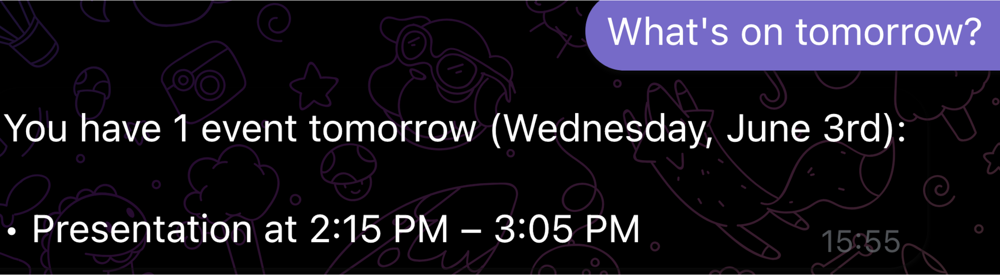
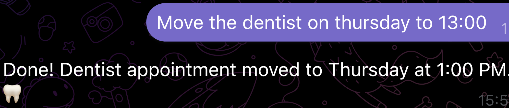

# Calendar Agent

A personal AI assistant that manages your Google Calendar through Telegram. Message it from your phone to check your day, add events or move meetings, and get a planned-out morning briefing every day at 8:00.

Runs 24/7 on a free Oracle Cloud VM using [OpenClaw](https://docs.openclaw.ai/) as the agent gateway and Claude Haiku as the model. Total cost is well under $1/month.

## Example

**Adding an event**



**Checking a day**



**Moving an event**



And every morning at 8:00, without asking:

```
Agent:  Good morning! Today you have:
        • Team sync at 10:00
        • Deep work at 11:00
        • Dentist at 16:30

        Suggested plan:
        08:30–10:00  Focus block (email, small tasks)
        10:00–10:30  Team sync
        11:00–13:00  Deep work
        13:00–14:00  Lunch
        14:00–16:00  Second focus block
        16:30        Dentist
```

## Architecture

```
┌──────────────┐
│   Telegram   │  you, from your phone
└──────┬───────┘
       │ bot API
┌──────▼────────────────────────────────────────────────┐
│  Oracle Cloud VM  (Ubuntu 22.04, e2-micro, 1 GB RAM)  │
│                                                       │
│  ┌───────────────────┐   exec: curl   ┌────────────┐  │
│  │ OpenClaw gateway  │ ─────────────► │  Flask     │  │
│  │ agent loop, cron, │  localhost:5050│  calendar  │  │
│  │ sessions, channels│ ◄───────────── │  server    │  │
│  └─────────┬─────────┘                └─────┬──────┘  │
│            │                                │         │
│  Tailscale serve → dashboard (private)      │         │
└────────────┼────────────────────────────────┼─────────┘
             │                                │
      ┌──────▼──────┐                 ┌───────▼────────┐
      │ Anthropic   │                 │ Google Calendar│
      │ API (Haiku) │                 │ API (OAuth)    │
      └─────────────┘                 └────────────────┘
```

**Message flow:** Telegram delivers your message to OpenClaw → OpenClaw sends it to Claude along with `SOUL.md` and `TOOLS.md` → Claude decides to run a `curl` against the local Flask server via the exec tool → Flask calls the Google Calendar API → the result goes back to Claude, which writes a human-readable reply → OpenClaw sends it to Telegram.

| Component | Role |
|---|---|
| `calendar_server.py` | Flask API exposing Google Calendar on `127.0.0.1:5050` |
| OpenClaw | Agent loop, Telegram channel, cron scheduler, dashboard |
| `SOUL.md` | Agent persona and formatting rules |
| `TOOLS.md` | Tells the agent which curl commands to run |
| Tailscale | Private access to the OpenClaw dashboard, no open ports |
| systemd | Keeps both services running across reboots |

## Repository layout

```
calendar-agent/
├── calendar_server.py              # Flask Google Calendar API
├── requirements.txt
├── deploy/
│   └── calendar-server.service     # systemd unit
└── openclaw/
    ├── openclaw.example.json       # config template (no secrets)
    └── workspace/
        ├── SOUL.md
        └── TOOLS.md
```

## Calendar API

All endpoints listen on localhost only and have no authentication.

| Method | Endpoint | Body |
|---|---|---|
| `GET` | `/events/today` | — |
| `POST` | `/events/create` | `title`, `start_time`, `end_time`, `description?` |
| `POST` | `/events/reschedule` | `event_id`, `new_start`, `new_end` |
| `GET` | `/health` | — |

Times are ISO 8601 (`2026-01-15T09:00:00`). The timezone defaults to `Europe/Bratislava` and can be changed with the `CALENDAR_TZ` environment variable.

```bash
curl -s http://localhost:5050/events/today
# {"result": "[abc123] Team sync at 2026-01-15T10:00:00+01:00"}
```

## Setup

### 1. Google Calendar credentials

1. In [Google Cloud Console](https://console.cloud.google.com), create a project and enable the **Google Calendar API**
2. Configure the **OAuth consent screen** (External), then **publish** it. Apps left in Testing mode have refresh tokens that expire after 7 days
3. Create an **OAuth 2.0 Client ID** of type **Desktop app** and save it as `credentials.json`

### 2. Generate the token (on a machine with a browser)

```bash
pip install -r requirements.txt
python3 calendar_server.py   # opens a browser, creates token.json
```

### 3. Server

```bash
# Node 22 (Ubuntu's apt version is too old)
curl -fsSL https://deb.nodesource.com/setup_22.x | sudo -E bash -
sudo apt install -y nodejs python3-pip

# Copy the project, credentials.json and token.json to ~/calendar-agent
pip3 install -r requirements.txt --break-system-packages

sudo cp deploy/calendar-server.service /etc/systemd/system/
sudo systemctl daemon-reload
sudo systemctl enable --now calendar-server
curl http://localhost:5050/health
```

On a 1 GB VM, add swap before installing OpenClaw or the install may freeze the machine:

```bash
sudo fallocate -l 1G /swapfile && sudo chmod 600 /swapfile
sudo mkswap /swapfile && sudo swapon /swapfile
echo '/swapfile none swap sw 0 0' | sudo tee -a /etc/fstab
```

### 4. OpenClaw

```bash
npm install -g openclaw@latest
openclaw onboard --install-daemon

cp openclaw/openclaw.example.json ~/.openclaw/openclaw.json   # then fill in your keys
cp openclaw/workspace/*.md ~/.openclaw/workspace/
openclaw gateway restart
```

Create a Telegram bot with [@BotFather](https://t.me/BotFather) and get your user ID from [@userinfobot](https://t.me/userinfobot).

### 5. Morning briefing

```bash
openclaw cron add \
  --name "Morning briefing" \
  --cron "0 8 * * *" \
  --tz "Europe/Bratislava" \
  --session isolated \
  --message "Check today's calendar with curl http://localhost:5050/events/today, summarise it and suggest a focused plan with work blocks and breaks." \
  --announce \
  --channel telegram \
  --to "YOUR_TELEGRAM_USER_ID"
```

### 6. Remote dashboard (optional)

Install [Tailscale](https://tailscale.com) on the VM and your laptop, keep `gateway.bind` on `loopback` with `tailscale.mode: serve`, and add your `*.ts.net` URL to `gateway.controlUi.allowedOrigins`.

## Gotchas

- **Heartbeats burn tokens.** OpenClaw's default heartbeat runs a full agent turn every 30 minutes, even when you never message it. Set `"heartbeat": { "every": "0m" }`.
- **`invalid_grant` errors** mean the Google token was revoked, the app is in Testing mode, or you generated a new client secret. Re-run step 2 and copy the new `token.json`.
- **The agent tries `fetch` before `curl`** and hits SSL errors. `SOUL.md` and `TOOLS.md` both explicitly forbid it.
- **Raw JSON in replies:** send `/reset` in Telegram after editing workspace files so the session picks them up.
- **Exec approvals** — the agent asks before each command until you run `/elevate`. Only do this when `allowFrom` restricts the bot to you.
- **`gateway.mode` must be `local`** or the gateway hangs on startup.
- **Dashboard auth** is set to `none` because the token mode was buggy; Tailscale already restricts access to your own devices.

## Secrets

These are git-ignored and must never be committed: `credentials.json`, `token.json`, `openclaw.json`, `.env`. If a Telegram bot token leaks, revoke it via @BotFather → `/mybots` → API Token.

## License

MIT
